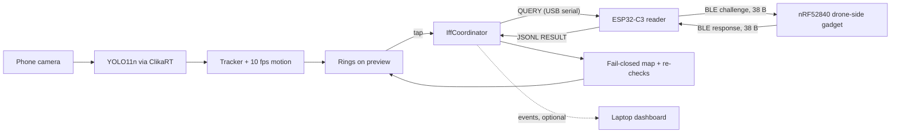

# FriendOrFoe: radio-silent, camera-anchored drone IFF on a phone

**Point a phone at a drone. Within seconds, with no network, the ring on that drone turns green (FRIEND) or red (FOE or UNKNOWN), and red always comes with a reason. The friendly drone stays silent until a question it can verify reaches it.**

Track: **T1 UAS & CUAS**, guidance item **T1-04 Radio-silent IFF** ("a cryptographic two-component IFF scheme that identifies friendly and enemy drones with minimal RF emission; resist MITM and replay"). Sub-track: **SC1 CLIKA BYOD Offline AI Challenge**. Repository: <https://github.com/chloeyeo/FriendOrFoe>.

## TL;DR

- **Problem.** A vehicle crew sees a small drone and must decide quickly whether it is theirs. Today they guess, or ask on the radio, and asking on the radio gives their position away.
- **What we built.** An Android observer app that detects drones in the camera image on the device, using ClikaRT 0.6.4 in-process with the phone in airplane mode. A tap on a drone starts a cryptographic challenge-response through a small USB-attached reader gadget. The drone-side gadget transmits nothing until a valid challenge reaches it.
- **The novelty.** The cryptographic answer is bound to the object the crew tapped, not to a radio channel: tap, lock the box, then challenge.
- **Detection (measured on phone A: Samsung Galaxy A06, MediaTek Helio G85, CPU only, airplane mode).** A drone-trained YOLO11n at 480x480 runs in 275-345 ms per frame through ClikaRT's graph runtime. The drone-trained RT-DETR it replaced took 1.27-4.4 s, so detection is 3.7-16x faster. A 10 fps motion tracker keeps the ring on the drone between detections.
- **Security on the radio today.** A 38-byte HMAC-SHA256 challenge-response with a fresh 16-byte hardware-random nonce, plus a nonce ledger and a timing gate on the phone. Silence, malformed data and link errors never produce FRIEND.
- **Honest scope.** Our full protocol, FOF-1, adds per-day and per-drone keys and position binding. It exists as a spec, a Python reference and 8 deterministic test vectors, but it is not yet on the boards. Each claim below states its evidence level.

---

## 1. The problem we solve

### 1.1 The operational scenario

A tank crew is buttoned up, loud and almost blind upward, and the sky above it is full of small drones. Some are their own, spotting for them; others are hunting them. When one appears, the crew has seconds to decide whether to ignore it, report it or engage it. Our pitch puts it plainly: "A tank crew sees a drone. Ours or theirs? Today they either guess, or ask on the radio, and a radio question gives away where they are."

Both errors are expensive: shooting down a friendly drone loses the asset, ignoring a hostile one invites a strike. Without a quick ID, the fallback is to jam or engage everything (Business Insider has reported soldiers who "jam everything"), which blinds friendly drones too.

The camera points at the object that matters and tells you *that* a drone is there and *where*, but not *whose* it is. FriendOrFoe adds that missing answer.

### 1.2 Why existing approaches fall short for small drones

| Approach | Why it does not solve this |
|---|---|
| Military transponder IFF (Mode 4/5) | Cryptographic and time-based, but needs aircraft-class certified hardware; Mode 5 Level 2 broadcasts unprompted |
| Remote ID / DJI DroneID | Unauthenticated public broadcasts: Remote ID can be spoofed (RFC 9575), and DJI DroneID read by AeroScope was reportedly used to locate Ukrainian operators (C4ISRNET) |
| IR tape or IR beacons | No cryptography, so anyone can copy the marker |
| Network-level drone ID | Tells the network what is flying, not whether *this object* in the gunner's view is friendly |

Moved onto a radio and applied to drones, the classic spoken challenge-and-password idea ("tiger" / "lion") fails in four ways:

1. **Beaconing reveals position.** A responder that always transmits, or answers anyone, can be found by direction finding.
2. **Replay and harvesting.** An adversary records a valid answer and plays it back, or asks "tiger" first to harvest "lion".
3. **No attribution.** With several drones up, an RF answer cannot be tied to the one the crew is watching.
4. **No direction.** RF alone does not say which object answered.

### 1.3 Constraints we designed for

- **Radio silence.** The friendly drone transmits nothing until asked, and the question cannot be reused by anyone else.
- **Offline.** No cloud, data link or map server.
- **Cheap hardware.** A budget phone and two low-cost microcontroller boards.
- **Seconds to decide.** A challenge resolves within seconds or fails visibly.
- **Fail closed.** No answer, a broken answer or a late answer never becomes a green ring.

---

## 2. Purpose: what FriendOrFoe does

FriendOrFoe tells the crew *whose* drone they are looking at, while the friendly drone transmits nothing until a verified question reaches it.

### 2.1 User flow

1. The crew member holds up the observer phone. Every detected drone gets an **amber ring** labelled `drone · ?`.
2. They **tap the drone**. The box is locked for a 10-second challenge window with a countdown, and the tracker keeps the lock on that object while it moves.
3. The phone sends `QUERY` over USB to the **reader gadget**, an ESP32-C3. The reader draws a fresh 16-byte nonce from hardware entropy and broadcasts one authenticated challenge over BLE for at most 600 ms.
4. The **drone-side gadget** (an NU40DK nRF52840 dev board; bench only so far) listens passively. It answers only if the challenge's HMAC verifies, and its response binds the same nonce and both IDs.
5. The reader verifies the response and reports a JSONL `RESULT` to the phone.
6. The phone maps the result fail-closed, runs its own **re-checks** (a nonce ledger and a time budget) and paints the verdict on the locked box:
   - green `FRIEND · drone <id> · <ms>`;
   - red `FOE · <reason>`: on the real reader path `bad tag`, `replayed nonce` or `late response`;
   - red `UNKNOWN · <reason>`, such as `no response`, `stale result`, `no gadget` or `link error`.
7. The verdict is held for 8 seconds at the object's tracked position; then the box can be challenged again.

In short: the HMAC tag proves **who** answered (on the radio today); the locked camera box shows **which object** answered (phone); a fresh nonce and time budgets show **when** it answered (firmware and phone). **Where** the drone is flying is designed into FOF-1 but not yet running.

### 2.2 Design principles

- **Silence is never a friend.** FRIEND requires every positive condition at once: reader verdict FRIEND, reason NONE, `response_received`, a `response_ms` value, and no `replay` flag. If anything is missing, the result is UNKNOWN, drawn red.
- **The stricter verdict wins.** Severity runs FRIEND < UNKNOWN < FOE, and a phone re-check can only push a verdict toward FOE.
- **Faults are visible.** The default signal source is the USB gadget, so a missing gadget gives `UNKNOWN · no gadget`. The simulator must be selected explicitly, and its verdicts are tagged `FAKE`.
- **Late answers are logged, never drawn**, and a tap never waits on inference: detection runs on its own thread.

---

## 3. System architecture

| Component | Hardware | Role |
|---|---|---|
| Observer app (`app/`, Kotlin + Compose) | Android phone, arm64, minSdk 28 | Camera, ClikaRT detection, tracking, tap-to-challenge, verdict rings, event log |
| Reader gadget (`firmware/reader/`) | ESP32-C3 on USB to the phone | Turns `QUERY` into a BLE challenge, verifies the response, reports JSONL |
| Drone-side gadget (`firmware/drone/`) | NU40DK nRF52840 dev board, on the bench | Listens passively; answers only verified challenges |
| Shared firmware library (`firmware/iff/`) | Both boards | Packet format, HMAC, BLE framing, FOF-1 skeleton |
| Dashboard (`laptop/dashboard/`, `web/`) | Windows laptop, optional | Live verdict feed for the judges |
| Cross-platform app (`app-cross/`) | Android / iPhone | React Native port of the observer logic |



We built in three streams around **three contracts frozen in code** from the start: `Detector` / `Detection` / `BoxF` (detection to app), `SignalSource` / `SignalEvent` (app to gadget) and `ObserverUiState` / `IffState` (session logic to UI). Each stream built against fakes of the other two (`FakeDetector`, `FakeSignalSource` and a scripted `DemoScenario`), so detection, challenge logic and UI were developed in parallel and merged in one evening.

---

## 4. Tech stack

| Layer | Technology and version |
|---|---|
| On-device AI | ClikaRT Kotlin binding `io.clika:clika-runtime` 0.6.4 (AAR, arm64-v8a) |
| Default drone detector | YOLO11n, `marie-kjelberg/drone-detector`, fixed 480x480 fp32 ONNX via ClikaRT `OnnxModel` (AGPL-3.0 weights, not committed) |
| Android build | AGP 9.2.1, Kotlin 2.2.10, Gradle 9.4.1; minSdk 28, targetSdk 36, Java 11 |
| UI / camera | Compose BOM 2026.02.01; CameraX 1.4.1 |
| Android support | coroutines 1.10.2; OkHttp (`okhttp-jvm`) 5.5.0; usb-serial-for-android 3.9.0 |
| Reader firmware | ESP32-C3: Arduino-ESP32 3.3.12, NimBLE-Arduino 2.5.0, mbedTLS (bundled) for HMAC |
| Drone-side firmware | nRF52840: NUBoards nRF52 core 1.0.2, S140 SoftDevice (Nordic's BLE stack), CryptoCell HMAC via Adafruit nRFCrypto |
| Laptop | `clikart-cli` 0.6.4 (Windows x86_64) and the ClikaRT JVM binding; Python 3.13 + FastAPI; Svelte ^5.57.1 / SvelteKit / Vite ^8.3 |
| Cross-platform | Expo SDK 57, React Native 0.86.3, React 19.2.3, TypeScript ~6.0.3; Core ML on iOS |

### 4.1 On-device AI with ClikaRT

**In-process, CPU, offline.** The ClikaRT AAR ships its native runtime inside the APK. The offline license is embedded at build time from a local file that is never committed or logged, and models are pushed into app storage with `adb`. At startup the app loads the runtime with 2 threads and runs a tensor-op probe (`Ops.add` on two CPU tensors). If the license is refused, the status strip shows its code (`LICENSE_FAILED`, `LICENSE_EXPIRED`, …) instead of an unexplained detector failure.

We use both ClikaRT paths:

- **Modelverse** (`ClikaRtDetector`): `AutoModelForObjectDetection.fromPretrained(dir, offline = true)` and an object-detection pipeline.
- **Graph runtime** (`OnnxYoloDetector`, the default): `OnnxModel.open` → `compile` → `ModelGraph.optimize(specialize = true)` → `finalizeGraph` → `run`, then our own YOLO post-processing (letterbox, NMS, a drop of boxes covering over 60% of the frame, a 0.40 confidence floor).

**How we chose the model.**

1. **COCO RT-DETR v2 r18**, with aeroplane, bird and kite as drone proxies: a median 3,497 ms per frame on phone A, and it **never boxed our real DJI drone**.
2. **Drone-trained RT-DETR v2 R50.** It found 6/6 drone test photos on the laptop. On the phone it took 9-10 s per frame at 640 input. At 224 input it took 1.27-4.4 s and still missed the hand-held drone.
3. **Drone-trained YOLO ONNX models.** We benchmarked **11 models** (10 Hugging Face repos; one appears as two variants) at up to 6 input sizes from 224 to 640: **61 timed configurations**, run on the laptop through the ClikaRT JVM binding.

The test set was built around our own drone: 2 real phone screenshots of it (with the app's boxes drawn on them) plus their mirror images; 240 synthetic cut-outs from 480 down to 30 px wide at three blur levels; 126 drone-free images (40 crops of our own backgrounds and 86 public negatives); and 110 public drone boxes.

| Candidate | Result |
|---|---|
| marie YOLO11n @ 480 | AP50 (detection precision at 50% overlap) **0.540** on our drone, the best at its ~36 ms laptop cost; **26%** of public drone-free images produced a drone box, against **73%** for the old RT-DETR |
| marie YOLO11n @ 640 | AP50 0.614, but 480-550 ms per frame on the phone |
| TomSmail YOLOv8n @ 256x416 | 152-172 ms on the phone, but weaker in the live test |

ClikaRT's fp32 output matched onnxruntime box for box (laptop, JVM binding). The final pick came from a live test on the phone with the real drone.

**Measured on phone A** (CPU, 2 threads, airplane mode): **275-345 ms per frame**, about 3 detections per second, full-frame on 1280x720 camera frames; frames that arrive mid-inference are dropped, never queued. float16 and the Vulkan GPU path were both slower on this phone. Drones under about 60 px, roughly beyond 4-5 m, are unreliable for every model we tried, and hands and people are the main false-alarm risk.

### 4.2 Tracking between detections

Three detections a second is too few for a smooth ring, so a **10 fps grayscale motion tracker** fills the gaps. Every 100 ms it reads a 320x180 luma frame straight from the camera plane. Coarse-then-fine template matching moves each box and refuses to jump onto the background. Because detections arrive late, `fastForward` matches each one on the buffered frame closest to its capture time, then steps the box forward to the present.

| Motion path, measured on phone A | Value |
|---|---|
| Motion rate | 9.7-10.3 fps |
| One box per frame (48 / 160 / 400 px) | 0.46 / 1.1 / 2.9 ms |

Tracks keep stable IDs through IoU matching (≥ 0.3). A drone track coasts for **2.5 measured detection round times**, clamped to 1-5 s (about 1 s with YOLO), so a box disappears soon after the drone leaves. Locked boxes never time out. The tracker models translation only and can lose a box against textureless sky.

### 4.3 The challenge-response protocol and its cryptography

The project has **two protocol layers**, and every claim here keeps them apart.

**What flies today** is a 38-byte HMAC exchange in the reader and drone-side firmware:

```text
version:1 | type:1 (1=CHALLENGE, 2=RESPONSE) | readerId:2 | droneId:2 | nonce:16 | tag:16   (38 bytes)
tag = HMAC-SHA256(key, "CHALLENGE" or "RESPONSE" || first 22 bytes)[0:16]
```

The response binds the full nonce and both IDs. The domain string and type byte stop a challenge tag from being reused as a response tag (host-tested). Tags are compared in constant time, key buffers are zeroed after use on the nRF side, and nonces come from hardware entropy. One 32-byte key is shared by both boards, provisioned over USB serial with `KEY <64 hex>`. There is no default key: a board without one neither queries nor answers.

**What we designed** is **FOF-1** (`docs/PROTOCOL.md`; reference implementation `eval/gen_vectors.py`). It adds:

- **Key hierarchy.** `dayKey = HMAC(master, "FOF-day" || YYYYMMDD)` and `droneKey = HMAC(dayKey, "FOF-drone" || droneId)`, so a captured drone exposes only that drone's key for one day.
- **Authenticated 31-byte challenge** carrying time and a challenger ID.
- **37-byte response** with latitude, longitude and altitude inside the tag.

The verifier runs four checks in order: the **nonce ledger** (unused and under 10 s old), the **tag**, a **position gate** (within 30 m passes, beyond 3 km fails, in between the bearing must be within ±20° of the observer's heading) and the **response budget** (2,500 ms). There are **8 deterministic vectors**, from a plain friend and a UTC-midnight rollover to a replayed nonce, a bad tag, a position mismatch at about 5.2 km and a late response at 4,000 ms. Re-running the generator gives a zero git diff.

**The C library `fof1.cpp` is still a skeleton** that returns "not implemented", so the on-board selftest would print FAIL for all 8 vectors by design until it is implemented; no on-board run is recorded. FOF-1 is our specification and acceptance test, not a running feature.

### 4.4 Firmware and gadgets

Both boards use BLE 5 extended, non-connectable advertising at 0 dBm (the NU40 has no Wi-Fi); the 38-byte message fits in one advertisement. In the committed source each side repeats its message for at most 600 ms, and the sender's MAC address plays no part in authentication.

**Radio-silence behaviour (implemented).**

- Nothing is transmitted at boot or on `STATUS`. Only `QUERY` sends a challenge, and the reader never retries on its own. During idle watches of 3 s and 6 s, neither board's USB event log showed a transmission (no TX logged; not an RF sniffer measurement).
- The drone transmits only after a challenge passes HMAC verification. A `ReplyCache` limits it to 3 sends per nonce and remembers 8 nonces for 6 s.
- The reader counts only answers that carry the current nonce and arrive within 3,000 ms. A forged packet does not end the query, so it cannot block a later valid answer.
- Keys are never printed, and the phone never sends `KEY`.

**Bench evidence.** The firmware stream ran 6 batches of 12 queries on a Mac bench, boards fixed in place, a fresh nonce per query:

| Batch | Drone scan | Reader challenge burst | Drone received | FRIEND |
|---|---|---|---|---|
| baseline | 100 ms | 200 ms | 3/12 | 3/12 |
| scan10 | 10 ms | 200 ms | 12/12 | 11/12 |
| adv600 | 100 ms | 600 ms | 12/12 | 8/12 |
| final repeat | 10 ms | 200 ms | 8/12 | **7/12** |
| all 6 batches | | | 49/72 | 37/72 (51%) |

Five of the six batches ran with a **200 ms** challenge burst; only `adv600` used the committed 600 ms. **Every failure was `NO_RESPONSE`**, with zero authentication or key errors: packets were lost in BLE reception before any cryptography ran (23 challenges never reached the drone, 12 answers never reached the reader). FRIEND `response_ms` ranged from 19 to 910 ms (median 233 ms).

### 4.5 Phone-to-gadget USB link and re-checks

`UsbGadgetSignalSource` opens the reader as a USB serial device (`303a:1001`) at 115200 baud. It polls for the device every 2 s and reopens the port after an unplug or an I/O error. **This link is verified on hardware:** phone A completes the handshake with the reader, and the gadget dot turns green. `ReaderLink` (489 lines, pure Kotlin) accepts only a compatible reader, detects reboots, rejects stale results by request ID and recovers lost replies.

| Reader result | Ring |
|---|---|
| FRIEND + NONE + `response_received` + `response_ms` | FRIEND |
| FRIEND with anything else | UNKNOWN · invalid result |
| AUTH_FAILED | FOE · bad tag |
| NO_RESPONSE | UNKNOWN · no response |
| `replay:true` | UNKNOWN · stale result |

**Re-checks** then run on the phone: a nonce ledger (a repeated nonce gives `FOE · replayed nonce`); a time budget (the phone's round trip and the reader's `response_ms` must both be ≤ 2,500 ms, otherwise `FOE · late response`); and an RSSI floor of −70 dBm (`FOE · signal mismatch`), skipped with a note because the current reader reports no RSSI.

### 4.6 Observer UI

A Compose canvas draws rings over a CameraX preview, with a **status strip** (OFFLINE/ONLINE badge, detector, ms per frame, fps, gadget dot), a **gadget panel** with the last 20 answers, and an **event log** with verdict counts. Logs truncate long hex runs, so nonces never show in full. **Reset** clears tracks, the nonce ledger, verdicts and the lock.

The OFFLINE badge requires airplane mode **and** no validated network (Samsung keeps Wi-Fi on in airplane mode once enabled there, so our runbook also turns Wi-Fi off). For the pitch there is a 7-step scripted **demo mode** and the **FakeSignalSource**, a simulated gadget with seven modes from HONEST to IMPOSTOR; every verdict it produces is tagged `FAKE`.

### 4.7 Cross-platform app, laptop and dashboard (SC1 device types)

| Device type | ClikaRT use | Status |
|---|---|---|
| Android arm64 phone (native app) | In-process AAR: modelverse and `OnnxModel` graph runtime | **Measured on phone A**, airplane mode |
| Windows x86_64 laptop | `clikart-cli 0.6.4 serve --offline` (RT-DETR, OWLv2); ClikaRT JVM binding for the benchmark | `serve` verified during research; benchmark measured |
| Android via React Native (`app-cross/`) | ClikaRT modelverse in a native module | Written, **not yet compiled or run on a phone** |
| iPhone (`app-cross/`) | Core ML via Vision; ClikaRT has no iOS runtime | Runs on iPhone; not claimed for SC1 |

`app-cross/` is a line-by-line TypeScript port of the observer logic with about 90 jest cases; its laptop bridge to the reader passes only `QUERY`, `STATUS` and `HELP`, so a key never crosses the network. The **dashboard** is FastAPI on port 8081 with a Svelte 5 page; the phone posts to it fire-and-forget with a 500 ms timeout, so a missing laptop never slows the observer.

> **SC1 checklist:** built with ClikaRT 0.6.4 in-process (Android AAR) ✔ · runs in airplane mode with Wi-Fi off ✔ · two ClikaRT device types: Android arm64 phone (measured) and Windows x86_64 laptop (`clikart-cli serve`, JVM benchmark) ✔ · code: <https://github.com/chloeyeo/FriendOrFoe> ✔

---

## 5. Security analysis

Status key: **Radio** = running on the boards today · **Radio code + host test** = flashed and host-tested, not exercised on hardware · **Phone** = implemented and unit-tested in the app · **Vectors** = FOF-1 reference only · **Scripted** = shown with FakeSignalSource, tagged FAKE · **Open** = not addressed.

| Attack | What catches it | Status |
|---|---|---|
| Locating the drone by emissions | Drone silent until a verified challenge; reader silent until `QUERY` | **Radio** (idle: no TX logged) |
| Harvesting ("ask tiger first") | Drone answers only HMAC-valid challenges | **Radio code + host test** |
| Impostor (wrong key) | `AUTH_FAILED` → `FOE · bad tag` | **Radio code + host test; not exercised on hardware** (0 AUTH_FAILED in 72 bench trials); mapping **Phone**; **Scripted** demo |
| Replayed response | Reader accepts only the current nonce; phone ledger → `FOE · replayed nonce` | **Radio + Phone**; **Scripted** demo |
| Replayed challenge to the drone | ReplyCache, 8 nonces for 6 s | **Radio, partial**: after expiry or a reboot the drone answers again; useless, but an attacker-caused emission |
| Tag reuse across directions | Domain strings plus type byte | **Radio**, host-tested |
| Bit flips, truncation | A flip of the lowest bit of every byte, and every truncation, is rejected | Host tests (not re-run here) |
| Stale result over USB | `replay:true` → `UNKNOWN · stale result` | **Phone** |
| Relay / MITM | Reader 3,000 ms timeout; phone 2,500 ms → `FOE · late response` | **Partial**: a fast relay passes. Position binding is **Vectors** only; the RELAY demo is **Scripted** |
| Far-away responder | RSSI floor → `FOE · signal mismatch` | **Phone, inactive** (reader reports no RSSI) |
| Jamming or silence | `UNKNOWN · no response`, never FRIEND | **Phone** |
| Wrong object credited | 10 s box lock; late answers never drawn | **Phone**; multi-responder arbitration **Open** |
| Fingerprinting the responder by BLE address | Address randomisation not configured | **Open** |
| Captured drone gadget | Per-drone, per-day keys | **Vectors**; on hardware one shared key is stored unencrypted, so capture means re-keying the fleet: **Open** |
| Key leak through tooling | Keys never printed or sent by the phone; bridge blocks `KEY`; none committed | Implemented; git history scanned |

**Net effect.** Without the key, an adversary cannot make a drone answer, forge a FRIEND or reuse a recorded answer, and jamming produces a red UNKNOWN. The weakest point is **relay**, which today is bounded only by timing. FOF-1's position binding is the fix and the first item on our roadmap.

---

## 6. Engineering quality and verification

| Suite | Count | Status |
|---|---|---|
| Kotlin JVM unit tests (`app/src/test`: 39 test classes) | 281 | Run: all passed |
| Python reader GUI tests + dashboard pytest | 22 + 4 | Run: all passed |
| Firmware host tests (C++17, ASan/UBSan, independent Python HMAC vectors) | 5 | Pass per the firmware README; not re-run (no compiler on this laptop) |
| app-cross jest | about 90 cases | Per the teammate's README (86); not re-run |
| FOF-1 vectors | 8 | Deterministic; checked against the Python verifier |

The app has 7,840 lines of main Kotlin and 4,083 lines of tests. The reader-link tests replay FRIEND and NO_RESPONSE lines captured on the firmware bench; the other reader lines are built from `reader.ino`'s format strings, and reboot, unplug and malformed input are scripted in a fake port.

**Process.** 120 commits between 12:51 and 23:44 on the day; three streams working against fakes, an `area: what` commit convention and planning in `.planning/`. A history scan confirms that no license, model weight or APK was ever committed. There is no CI; tests were run locally.

---

## 7. Military deployability

**Cost-class hardware.** The observer is an entry-level phone (Helio G85, CPU only), the integration lead's own handset. The gadgets are ESP32-C3 and nRF52840 development boards. Nothing needs certified avionics, a GPU or a data link.

**Emission control.** The reader is silent until the operator taps; the vehicle then emits one short, low-power burst per tap, at most 600 ms at 0 dBm on the BLE advertising channels. The drone-side gadget is silent until a challenge with a valid HMAC reaches it. Compared with a transponder or a Remote ID beacon, the friendly drone's RF signature between questions is near zero, and without the key an adversary cannot provoke an answer (two exceptions, the ReplyCache gap and the fixed BLE address, are in section 5).

**Range: the first question a crew will ask.** Today's numbers are short-range. Detection is reliable only to about 4-5 m, and the BLE range at 0 dBm has not been measured, because the bench boards were fixed in place. Operational drones are usually much farther away. The path to longer range uses the same contracts and does not change the fail-closed logic: a vehicle optic or zoom camera feeding `Detector`, a detector trained for small, distant drones, and higher transmit power or a directional antenna on the reader.

**What one tap means.** On the bench, the committed 10 ms drone scan gave 11/12 and 7/12 FRIEND in its two batches, 18/24 (75%) per query, both with a 200 ms challenge burst. If losses were independent, two taps would succeed about 94% of the time; that is an estimate, not a measurement. The operator rule is simple: **if the ring says `UNKNOWN · no response`, tap again.** A lost packet costs a second tap, never a false FRIEND.

**Not yet measured.** The full tap-to-ring time (the reader's `response_ms` seen on the phone was about 460 ms), phone battery drain, the gadget's power and weight on a drone, and a key rotation procedure. Today keys load only over a wire.

**Offline and failure behaviour.** Detection, tracking, verification and logging all run on the phone in airplane mode, and the dashboard is optional. Every fault (no gadget, an unplug mid-query, a reboot, busy, key not set, a radio error, a timeout) gives a visible red UNKNOWN with a reason, and the USB link recovers by itself when the cable is reseated.

**Fielding path.** The contracts isolate the parts that will change: a ruggedised handset or vehicle camera can replace the phone, a better detector drops in behind `Detector`, and FOF-1 replaces the 38-byte packet behind `SignalSource`. The fail-closed mapping, re-checks and UI stay as they are. Production keys should become per-drone Ed25519 signatures, so that a captured drone holds no fleet secret.

---

## 8. Limitations and roadmap

**Limitations.**

- **FOF-1 is not on the radio.** Its C implementation is a stub; there is no position check on the hardware, and relay is bounded only by timing.
- **Keys.** One shared key, stored unencrypted on both boards.
- **Attack demos are simulated.** The drone-side gadget has no attack modes. Replay, Relay, Impostor, Late and Weak run on the FakeSignalSource, labelled `FAKE`.
- **End-to-end FRIEND on the phone with the NU40 drone-side gadget had not been confirmed at the time of writing.** The USB reader link is verified on hardware, and the BLE exchange is verified on the bench.
- **Detection data.** The own-drone test set has only 2 real images, plus mirrors and synthetic cut-outs; range and false alarms are covered in section 4.1.
- **State is in memory.** The phone's nonce ledger does not survive an app restart.
- **Licensing.** The default weights are AGPL-3.0 and kept out of the repo; the obligations for a distributed binary are not settled.

**Roadmap.**

1. Implement `fof1.cpp` against the 8 vectors and add a Kotlin verifier, so that two independent implementations check each other.
2. Bind position and the challenger into the response and turn on the position gate, which closes the relay gap.
3. Report RSSI from the reader and calibrate the floor.
4. Find the BLE loss with a sniffer, bench the 10 ms scan with the 600 ms burst, and add address randomisation.
5. Move to per-drone keys, then Ed25519, with protected key storage.
6. Later: an optical answer channel, INS-based positioning for GPS-denied use, thermal for night, and a detector for small, distant drones.

---

## 9. What pre-existed vs what we built, and the team

**Pre-existed:**

- ClikaRT 0.6.4: runtime, Kotlin binding and `clikart-cli`;
- model weights: RT-DETR v2, OWLv2, D-FINE and the Hugging Face drone YOLO models, including marie YOLO11n (not committed);
- public drone and negative image sets, used only for the benchmark (including `pathikg/drone-detection-dataset`);
- Ultralytics, used only for ONNX export;
- the Android Compose template, CameraX, usb-serial-for-android and OkHttp;
- the Arduino cores, NimBLE-Arduino, mbedTLS and Adafruit nRFCrypto;
- the 38-byte message and its HMAC rule, which the firmware README describes as kept from an earlier ESP-NOW version;
- FastAPI, Svelte/SvelteKit, Expo/React Native and scrcpy.

**Built during the hackathon:** everything else in the repository.

- The Android observer app: camera pipeline, both ClikaRT integrations, YOLO decoding, motion tracker, tap-to-challenge coordinator, reader link, fail-closed mapping and re-checks, UI, demo mode, and 281 unit tests.
- The drone-model benchmark and its own-drone test set.
- The firmware for this setup: the move to BLE extended advertising, the reader and drone-side sketches, the ReplyCache, serial interface v2, host tests, the GUI and the bench diagnostics.
- FOF-1: its design, reference implementation and vectors.
- The React Native/iOS port, the dashboard and the web page.

| Member | Stream |
|---|---|
| **Chloe Yeo** | Detection and integration lead: ClikaRT pipeline, model benchmark and selection, tracking, coordinator, reader link, phone-side checks |
| **Ihan** | Firmware, cryptography, gadget link: ESP32-C3 reader, nRF52840 drone-side gadget, BLE HMAC link, bench diagnostics |
| **Yoo Jongho** | UI, cross-platform app (React Native / iOS), web dashboard |
| **Dawud** | Design |

A cheap phone sees the drone, a silent gadget proves who it is, and the answer is drawn on the object the crew is looking at. When the answer is uncertain, the ring stays red and says why.
